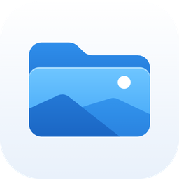

<p align="center">
  
</p>

<h1 align="center">Kobblo</h1>

<p align="center">
  <b>Your photos, files, servers and music, in one private app.</b><br>
  A gallery and file manager for Android that keeps everything on your phone.
</p>

<p align="center">
  
  
  
  
  <a href="LICENSE"></a>
  <a href="https://github.com/JkMulti/Kobblo/releases/latest"></a>
</p>

<p align="center">
  <a href="https://github.com/JkMulti/Kobblo/releases/latest"><b>Download</b></a> ·
  <a href="https://jkmulti.github.io/kobblo/">Website</a> ·
  <a href="https://jkmulti.github.io/kobblo/privacy/">Privacy policy</a> ·
  <a href="mailto:bitbyteapps51@gmail.com">Support</a>
</p>

---

## Why Kobblo

- **One app, not five.** Photos, files, your home server, your cloud storage and your music live
  side by side, so you stop jumping between apps to find one thing.
- **Private by design.** No account, no ads, no analytics. Your library is indexed and searched on
  the phone, and nothing leaves it unless you send it.
- **Smart, without the cloud.** Search photos by what's in them, copy the text in a photo, and see
  each person's photos together, all worked out on your phone.
- **Built to feel native.** A clean, calm design with large titles, grouped lists and smooth
  transitions, in 16 languages including Urdu and Arabic.

## One app instead of many

| What you want to do | What it usually takes | In Kobblo |
|---|---|---|
| Browse and organize photos and videos | A gallery app | ✅ Gallery with albums, Places and Smart Search |
| Manage files and folders | A file manager | ✅ Every storage volume, with drag and drop |
| Reach a NAS or home server | An FTP or SMB client | ✅ FTP, SFTP, SMB, WebDAV and Nextcloud |
| Open cloud storage | Each provider's own app | ✅ Google Drive, Dropbox and MEGA |
| Send files to a nearby device | A sharing app | ✅ Nearby Share and Web Share |
| Listen to your music | A music player | ✅ Library, queue, lyrics and equalizer |
| Keep private files safe | A vault app | ✅ Encrypted Vault |
| Read PDFs and documents | A document reader | ✅ PDF, Office, OpenDocument, EPUB and RTF |
| Open ZIP and RAR files | An archive app | ✅ Open ZIP and RAR, create ZIP |

## Kobblo at a glance

✅ Kobblo has it · ◐ Kobblo has part of it · ❌ Kobblo does not have it

| Feature | Kobblo |
|---|---|
| Find photos from a description ("dog on the beach") | ✅ On your phone |
| Find photos from the words in them | ✅ |
| Select and copy text in a photo | ✅ |
| Put each person's photos together, and name them | ✅ |
| Albums, Favorites and smart albums | ✅ Including On This Day, Screenshots and RAW |
| Photos grouped by where they were taken | ✅ Offline, by town |
| Map of your photos | ◐ Places by town, without a map |
| Find similar and duplicate photos | ✅ |
| Edit photos | ✅ Crop, rotate, straighten, filters, light and color |
| Motion photos and 360° photos | ✅ |
| Locked, encrypted folder | ✅ Vault, names included |
| App lock with PIN, pattern or password | ✅ |
| File manager with SD card support | ✅ |
| Servers and cloud storage | ✅ FTP, SFTP, SMB, WebDAV, Nextcloud, Drive, Dropbox, MEGA |
| Send files without the internet | ✅ Nearby Share, QR pairing and a local hotspot |
| Share files with any browser | ✅ Web Share |
| Music player | ✅ |
| Back up photos to the cloud | ❌ Kobblo keeps your library on your phone |
| Shared albums | ❌ |
| Edit videos | ❌ |
| Works without a Google account | ✅ |
| Smart features without the internet | ✅ After a one-time model download |
| Ads or tracking | ❌ None at all |
| Open source | ✅ GPL-3.0 |

## Download

Get the latest APK from [Releases](https://github.com/JkMulti/Kobblo/releases/latest) and open it on
your phone. Kobblo needs Android 8.0 or later.

Every release is signed with the same key. To check that an APK is genuine, compare its signing
certificate with this SHA-256 fingerprint, using a certificate-checking app or
`apksigner verify --print-certs`:

```
5C:08:20:20:0E:35:20:3C:AF:AB:C9:CD:17:E2:02:B4:D5:F6:38:C1:1D:C6:5E:A4:CF:10:28:D1:2B:46:48:99
```

Each release also lists the SHA-256 of the APK file itself.

## Contents

- [Download](#download)
- [Features](#features)
- [Smart Features](#smart-features)
- [Privacy](#privacy)
- [Permissions](#permissions)
- [Requirements](#requirements)
- [Build from source](#build-from-source)
- [Project structure](#project-structure)
- [Contributing](#contributing)
- [Support](#support)
- [License](#license)

---

## Features

### Gallery

- **One feed** of every photo and video, newest first, grouped by day and month, with a
  pinch-to-resize grid and drag to select a range.
- **Albums** for every folder, with covers you choose, folders you can leave out, and bulk actions.
- **Smart albums**: Favorites, Recently Added, On This Day, Camera, Screenshots, Videos, GIFs and RAW.
- **Places**: photos grouped by the town where they were taken, from a table built into the app.
- **Similar photos**: finds exact duplicates and photos that look alike, so you can keep the best one.
- **Photo editor**: crop with aspect ratios, rotate, flip, straighten, filters, and exposure,
  brightness, contrast, saturation and warmth.
- **Date fix** for photos with the wrong date, **library statistics**, and a **home-screen widget**.

### Viewer

- Photos, videos, **motion photos** (save the clip on its own) and **360° photos**.
- A **metadata explorer** for EXIF, XMP and video details.
- **Share without location**, or remove the location from a photo for good.
- Slideshow, set as wallpaper, print, copy the image, and save a frame from a video.

### Files

- Every storage volume, including SD cards, with search, sorting and per-folder views.
- **Drag to select**, **drag and drop** between folders, and a **trash** you can restore from.
- **Background jobs** for copying, moving, compressing and extracting, with progress that survives
  leaving the app.
- **Archives**: open ZIP and RAR, and create ZIP.
- **Documents**: read PDF, Office, OpenDocument, EPUB and RTF, and edit text files.
- **Tools**: storage analyzer, batch rename, App Manager, APK installer, and a file picker other apps
  can use.
- **Shizuku** support, optional, for folders Android normally keeps out of reach.

### Servers and cloud storage

- **Your own servers** over FTP, SFTP, SMB, WebDAV and Nextcloud.
- **Cloud storage** from Google Drive, Dropbox and MEGA, right next to your local files.
- Saved passwords are kept in Android's encrypted storage.

### Send and share

- **Nearby Share** sends files to devices on the same Wi-Fi, with no internet and no account.
- **QR pairing** to connect two phones in a moment, and a **local hotspot** when there's no
  shared network.
- **Web Share** gives you a link that any browser on the same network can open to download the files
  you picked.

### Music

- A library by artist, album and folder, with a queue, **crossfade**, synced **lyrics** and M3U playlists.
- **Equalizer** and **bass boost**.
- Background playback with lock-screen and headset controls.

### Vault and app lock

- **Vault**: files are encrypted on the phone, names included, and open with your password, your
  recovery key or your fingerprint.
- **App lock**: a PIN, pattern or password of its own, stored only as a salted Argon2id hash, with
  pauses after repeated wrong tries.
- **Screenshot blocking** and a blank card in recent apps while the app is locked.

## Smart Features

Smart Features run entirely on the phone and need Android 11 or later. Each one is off until you turn
it on, which downloads its model once.

| Feature | What it does | Model |
|---|---|---|
| Smart Search | Finds photos from a description, such as "birthday cake" | SigLIP 2 for Accurate, or OpenCLIP for Fast |
| Text in photos | Finds photos from the words in them, and lets you select and copy that text | PP-OCRv6 |
| People | Finds faces and puts each person's photos together | YuNet and SFace |

## Privacy

Kobblo has no servers of its own and collects nothing. It goes online only for the things you ask for:

| What | Where | When |
|---|---|---|
| Download a Smart Features model | Hugging Face | Only when you turn that feature on |
| Open a server or cloud storage | The server or service you added | Only while you browse it |
| Nearby Share and Web Share | Your local network, never the internet | Only while you share |

Everything else, including your photos, the search index, the people it finds and your Vault, stays
on your phone. The full policy is at https://jkmulti.github.io/kobblo/privacy/.

## Permissions

| Permission | Why Kobblo needs it |
|---|---|
| All files access | To show and manage the files, photos, videos and music on your phone |
| Location in photos | To read where a photo was taken, for Places |
| Camera | Only to scan a QR code when pairing two devices |
| Nearby Wi-Fi devices | To find other devices for Nearby Share |
| Location, Android 12 and older | Android requires it to find nearby Wi-Fi devices; Kobblo never reads where you are |
| Notifications | To show the progress of transfers and file jobs |
| Fingerprint or face | To unlock the Vault and the app lock |
| See, install and remove apps | For the App Manager, and to install an APK you open |
| Internet | For the tasks listed under [Privacy](#privacy) |

## Requirements

| | |
|---|---|
| Android | 8.0 (API 26) or later |
| Smart Features | Android 11 (API 30) or later |
| Target SDK | 36 |
| Package | `com.kobblo.gallery.file.explorer` |

## Build from source

You need Android Studio (recent) or JDK 17 or later. On a Mac with no system JDK, use the one that
comes with Android Studio:

```bash
export JAVA_HOME="/Applications/Android Studio.app/Contents/jbr/Contents/Home"
```

Build a debug APK, written to `app/build/outputs/apk/debug/app-debug.apk`:

```bash
./gradlew assembleDebug
```

Run the unit tests:

```bash
./gradlew testDebugUnitTest
```

Instrumented tests need a device or emulator. `connectedAndroidTest` uninstalls the app when it
finishes, so build the test APKs and run them by hand instead:

```bash
./gradlew assembleDebug assembleDebugAndroidTest
```

```bash
adb -s <serial> shell am instrument -w -e class <TestClass> com.kobblo.gallery.file.explorer.test/androidx.test.runner.AndroidJUnitRunner
```

<details>
<summary><b>Optional: WebDAV test server</b></summary>

The WebDAV tests can talk to a real server. Put its details in `local.properties`, which git ignores:

```properties
testWebdavUrl=https://example.com/dav/
testWebdavUser=me
testWebdavPassword=secret
testWebdavAllowSelfSigned=false
```

</details>

<details>
<summary><b>Release builds and signing</b></summary>

Release builds are shrunk with R8. Its keep rules are in `app/src/main/keepRules/rules.keep`. Saved
settings are read by field name, so any new class that is saved to disk needs a keep rule.

```bash
./gradlew assembleRelease
```

Without signing details the release APK is left unsigned, which is what F-Droid and other builders
expect. To sign it, put a `keystore.properties` in the project root. Git ignores it, and the keystore
too, so neither can be committed by mistake:

```properties
storeFile=path/to/your.jks
storePassword=...
keyAlias=...
keyPassword=...
```

On GitHub Actions the same values come from the `KOBBLO_KEYSTORE_BASE64`, `KOBBLO_KEYSTORE_PASSWORD`,
`KOBBLO_KEY_ALIAS` and `KOBBLO_KEY_PASSWORD` repository secrets.

MEGA requests carry an app key. The source has the placeholder `YOUR_KEY` in
`app/src/main/java/nz/mega/sdk/MegaClient.kt`; put your own key from [mega.io](https://mega.io) there.

</details>

<details>
<summary><b>Publishing a release</b></summary>

1. Raise `versionCode` and `versionName` in `app/build.gradle.kts`.
2. Add `fastlane/metadata/android/en-US/changelogs/<versionCode>.txt` with what changed.
3. Tag the commit with `v` and the version name, and push the tag:

```bash
git tag v1.0 && git push origin v1.0
```

The Release workflow runs the tests, builds and signs the APK, and publishes it on the Releases page
with its checksums.

</details>

## Project structure

All app code lives under `app/src/main/java/com/kobblo/gallery/file/explorer/`.

| Package | What it holds |
|---|---|
| `ui/` | The app shell, screens and the Kobblo design system (`ui/design/`) |
| `gallery/` | The photo feed, albums, Places, similar photos, the editor and the widget |
| `viewer/` | Photo, video, PDF, motion photo and 360° viewers, and the metadata explorer |
| `explorer/` | Folder browsing, search, sorting, drag to select and drag and drop |
| `fileops/` | Background file jobs, safe writes and file locks |
| `archive/` | Reading and writing archives |
| `data/` | Server and cloud connections |
| `transfer/`, `localsend/` | Nearby Share, QR pairing, the local hotspot and Web Share |
| `music/` | The music library, player, queue, lyrics and sound effects |
| `vault/` | The encrypted Vault |
| `security/` | App lock, the lock screen and screenshot blocking |
| `smart/` | Smart Search, text in photos and People |
| `tools/` | Storage analyzer, batch rename, App Manager, documents, text editor and file picker |
| `shizuku/` | Optional elevated file access |
| `compat/` | Permissions, storage access and language settings across Android versions |

| Folder | What it holds |
|---|---|
| `docs/design/design-system.md` | The Kobblo design system: colors, type, spacing and components |
| `scripts/app-icon/` | Generates the app icon |
| `scripts/i18n/` | Checks that every language has every string |
| `scripts/places/` | Rebuilds the offline places table in `app/src/main/assets/places.bin` |

## Languages

English, Arabic, Chinese, French, German, Hindi, Indonesian, Italian, Japanese, Korean, Polish,
Portuguese, Russian, Spanish, Turkish and Urdu.

## Contributing

Bug reports and ideas are welcome in [Issues](https://github.com/JkMulti/Kobblo/issues). For code,
open a pull request against `main`: the Build and test workflow runs the unit tests, the translation
check and a debug build on it. Please keep new strings translated into every language;
`scripts/i18n/check_translations.py` lists anything missing.

## Support

Questions, ideas and bug reports: **bitbyteapps51@gmail.com**

## License

Copyright © 2026 BitByte

Kobblo is free software: you can redistribute it and/or modify it under the terms of the
[GNU General Public License, version 3](LICENSE), or (at your option) any later version. It is
distributed in the hope that it will be useful, but without any warranty.

<p align="center"><sub>Crafted with ❤️ in Pakistan</sub></p>
